# sshTermy

**SSH-Terminal mit KI-Copilot** für Windows 11 ARM64, Windows x86 (32/64 Bit), macOS und Linux.
*Idee: Dominik Bornhäußer*

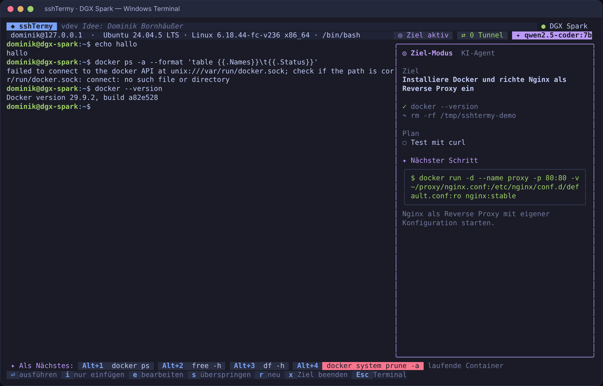

sshTermy ist eine schlanke Terminal-Anwendung (TUI, eine einzige Datei, ~9 MB, kein Installer, kein cgo) mit:

- **Verbindungs-Manager** mit verschlüsseltem Store (AES-256-GCM, Argon2id, unter Windows zusätzlich DPAPI)
- **echtem SSH-Terminal** (xterm-256color, Truecolor, vim/htop/tmux, Scrollback, Tabs, Jump-Host)
- **Dateien (F5)**: SFTP über dieselbe Verbindung, links lokal, rechts Server, Dateien und Ordner hoch- und herunterladen
- **Host-Übersicht (F6)**: Server zeigen beim Verbinden CPU, Last, RAM, Platte, Laufzeit und offene Updates. Switches (ArubaOS-Switch/ProCurve, ArubaOS-CX, Cisco IOS) zeigen auf Abruf Firmware, Ports und VLANs; die show-Befehle laufen sichtbar am Prompt, nie als versteckte Exec-Sitzung
- **Config-Sicherung für Switches**: `b` sichert `show running-config` verschlüsselt auf dem Rechner, `d` zeigt den Diff zum vorherigen Stand, unveränderte Stände werden nicht doppelt gespeichert
- **Tunnel-Manager**: `-L`, `-R`, `-D` (SOCKS5) und One-Click-Web-Services mit lokaler URL
- **KI-Copilot** für jeden OpenAI-kompatiblen Endpunkt (`/v1/chat/completions`: OpenAI, vLLM, SGLang, Ollama, LiteLLM, LocalAI)
  - **Befehlspalette** (Strg+Leertaste): ein Eingabefeld für alles, Text wird Ziel oder Frage, dazu Vorschläge, Tunnel, Verbindungen und Aktionen
  - **Ghost-Text** beim Tippen (Tab übernimmt)
  - **Folgebefehle** nach jedem Enter (Alt+1…4 fügt ein)
  - **Ziel-Modus / Agent** (F2): Ziel setzen, die KI schlägt Schritt für Schritt genau einen Befehl mit Begründung vor, du bestätigst
  - **Runbooks**: Ziele mit den ausgeführten Befehlen speichern (Strg+S) und wiederverwenden, der Agent nimmt sie als Vorlage
  - **Endpunkt-Test und Modellauswahl** in den KI-Einstellungen (Strg+T testet, Strg+L listet die Modelle von `/v1/models`)
  - **KI fragen** (F3) mit Terminal-Kontext, Befehle aus der Antwort per 1…9 einfügen
- **Sync zwischen Rechnern**: Verbindungen, Tunnel, Runbooks und Einstellungen Ende-zu-Ende verschlüsselt über einen Cloud-Ordner
  (OneDrive, Dropbox, iCloud, Syncthing) oder direkt über dein NAS (Synology, QNAP, Nextcloud, jeder WebDAV-Server)
- **Import** bestehender Verbindungen aus `~/.ssh/config`, PuTTY (Registry oder `.reg`-Export) und MobaXterm
  (`MobaXterm.ini`, `.mxtsessions`), mit Jump-Hosts und Ordnern, ein Tastendruck (i im Manager)
- **Themes** Dunkel, Hell und Hochkontrast (a im Manager) und **frei belegbare Tastenkürzel** (b im Manager)
- **Versionierung und Auto-Update** aus GitHub Releases (signiert)

Das Bedienkonzept der KI (Vorschläge, Ziel-Modus, feste Gefahrenregeln) stammt aus dem Fernzugang-Assistenten von
[speech-on-dgx-spark](https://github.com/db9979/speech-on-dgx-spark); die Technik ist hier neu in Go gebaut.

---

## Installation

Lade die passende Datei aus den [Releases](https://github.com/db9979/sshtermy/releases/latest):

| System | Datei |
|---|---|
| Windows 11 ARM64 (Surface Pro X/11, Snapdragon X) | `sshtermy_windows_arm64.exe` |
| Windows x86 32 Bit | `sshtermy_windows_386.exe` |
| Windows x64 | `sshtermy_windows_amd64.exe` |
| macOS Apple Silicon / Intel | `sshtermy_darwin_arm64` / `sshtermy_darwin_amd64` |
| Linux | `sshtermy_linux_amd64` / `sshtermy_linux_arm64` |

Empfohlen unter Windows: **Windows Terminal** (Truecolor, F-Tasten, Unicode). macOS: einmal
`xattr -d com.apple.quarantine sshtermy_darwin_arm64 && chmod +x sshtermy_darwin_arm64`.

```
sshtermy              # starten
sshtermy --version    # Version, Commit, Build-Datum
sshtermy --update     # auf die neueste Version aktualisieren
```

## Bedienung

| Wo | Taste | Wirkung |
|---|---|---|
| Manager | ⏎ / n / e / d / / / t / s / y | verbinden / neu / bearbeiten / löschen / suchen / Tunnel / KI-Einstellungen / Sync |
| | i / a / b | Verbindungen importieren / Aussehen wechseln / Tastenkürzel anpassen |
| Terminal | Tab oder → | Ghost-Text übernehmen |
| | Alt+1…4 | Folgebefehl einfügen (ohne Enter; rote zweimal) |
| | F2 | Ziel-Modus (Agent) |
| | F3 | KI fragen |
| | F4 | Tunnel an/aus, Web-Service im Browser öffnen |
| | F5 | Dateien (SFTP): Tab Seite, c kopieren (hoch/runter), n Ordner, d löschen, . versteckte |
| | F6 | Host-Übersicht: r/⏎ abfragen, b Switch-Config sichern, ↑↓ Stand, d Diff, v ansehen |
| | F7 / F8 | vorheriger / nächster Tab |
| | F10 | zurück zum Manager (Sitzungen laufen weiter) |
| Ziel-Modus | ↑↓ / Strg+S / Strg+D | Runbook wählen / Ziel als Runbook speichern / Runbook löschen |
| | ⏎ / i / e / s / r / x | ausführen / nur einfügen (Dry-Run) / bearbeiten / überspringen / neu / beenden |
| KI-Eingaben | ⇧⏎ / Strg+J | neue Zeile in Ziel, Frage und Palette (lange Texte brechen automatisch um, das Feld wächst mit) |
| KI-Einstellungen | Strg+T / Strg+L | Endpunkt testen / Modell aus der Liste des Endpunkts wählen |
| Überall | Strg+Leertaste | Befehlspalette: ⏎ als Ziel starten, Tab KI fragen, ↑↓ Vorschlag/Tunnel/Verbindung wählen |
| | F1 / F12 / Strg+Q | Hilfe / Über + Update / beenden |

Warum F-Tasten statt `Strg+A`? `Strg+A` ist in bash/zsh „Zeilenanfang“ und das Präfix von GNU screen. sshTermy
belegt nur Tasten, die Shells und Vollbildprogramme praktisch nie brauchen.

**Tasten anpassen** (b im Manager oder Palette → „Tastenkürzel anpassen“): Aktion wählen, ⏎, neue Taste drücken.
Entf setzt eine Aktion zurück, r alle. Doppelte Belegungen werden rot markiert. Alt+⏎ ist gesperrt, weil
Windows Terminal damit auf Vollbild schaltet. Die Belegung wandert mit dem Sync auf deine anderen Rechner.

**Aussehen:** a im Manager wechselt Dunkel → Hell → Hochkontrast (oder Palette → „Aussehen“). Die Schriftgröße
gehört dem Terminalfenster: Strg + Plus/Minus in Windows Terminal, ⌘ + / − unter macOS.

**Import** (i im Manager): sshTermy sucht selbst nach `~/.ssh/config` (mit `Include`, `Host *`-Vorgaben und
`ProxyJump`), den PuTTY-Sitzungen in der Registry und `%APPDATA%\MobaXterm\MobaXterm.ini`. Neue Ziele sind
vorausgewählt, schon vorhandene abgewählt; ⏎ übernimmt. Mit f lädst du eine Datei von woanders, z. B. einen
PuTTY-Export (`reg export HKCU\Software\SimonTatham\PuTTY putty.reg`), eine portable `MobaXterm.ini` oder eine
`.mxtsessions`-Datei. Passwörter werden nicht übernommen, sshTermy fragt beim ersten Verbinden. PuTTY-Keys
(`.ppk`) bitte in Pageant laden oder mit PuTTYgen nach OpenSSH exportieren.

## Screens

| Entsperren | Verbindungs-Manager |
|---|---|
| 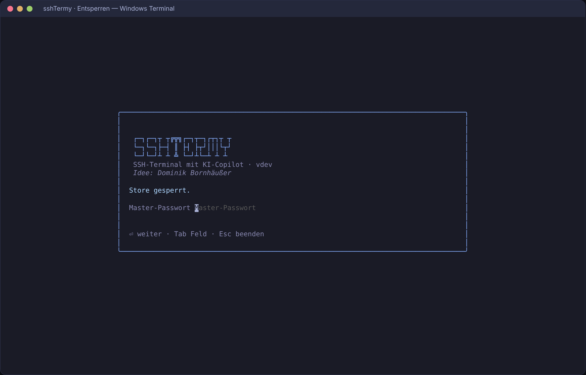 | 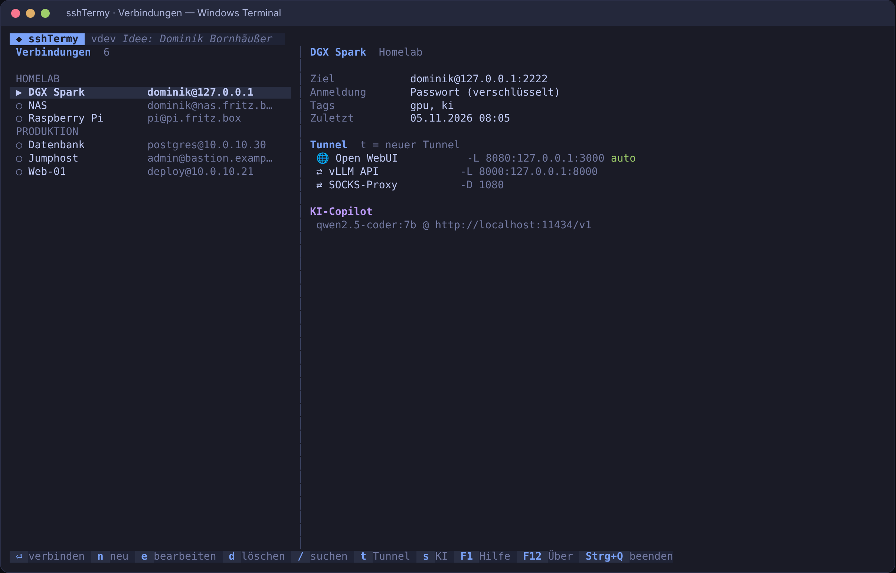 |
| **Ghost-Text** | **Gefährlicher Befehl** |
| 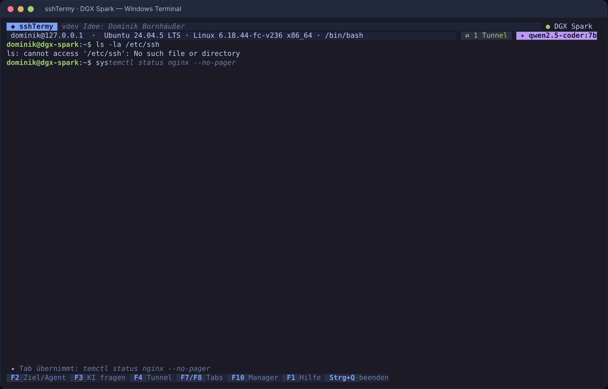 | 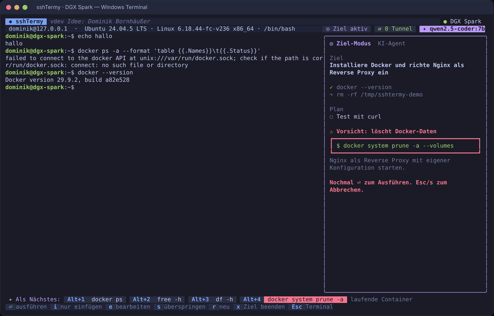 |
| **KI fragen** | **Tunnel & Web-Services** |
| 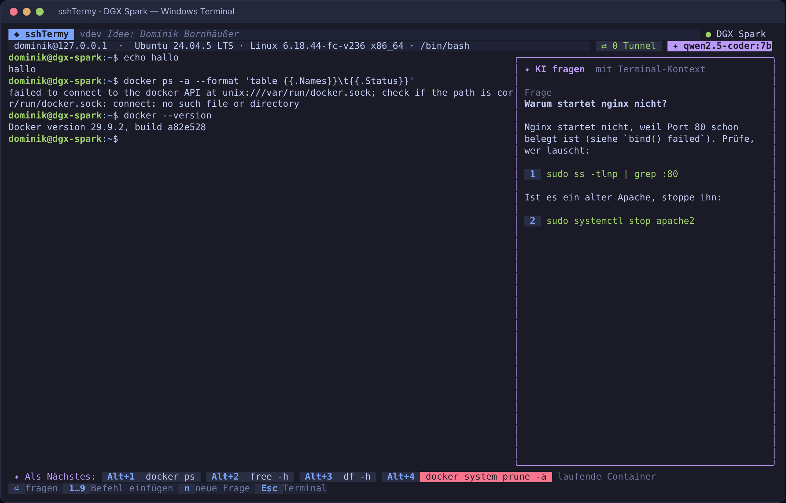 | 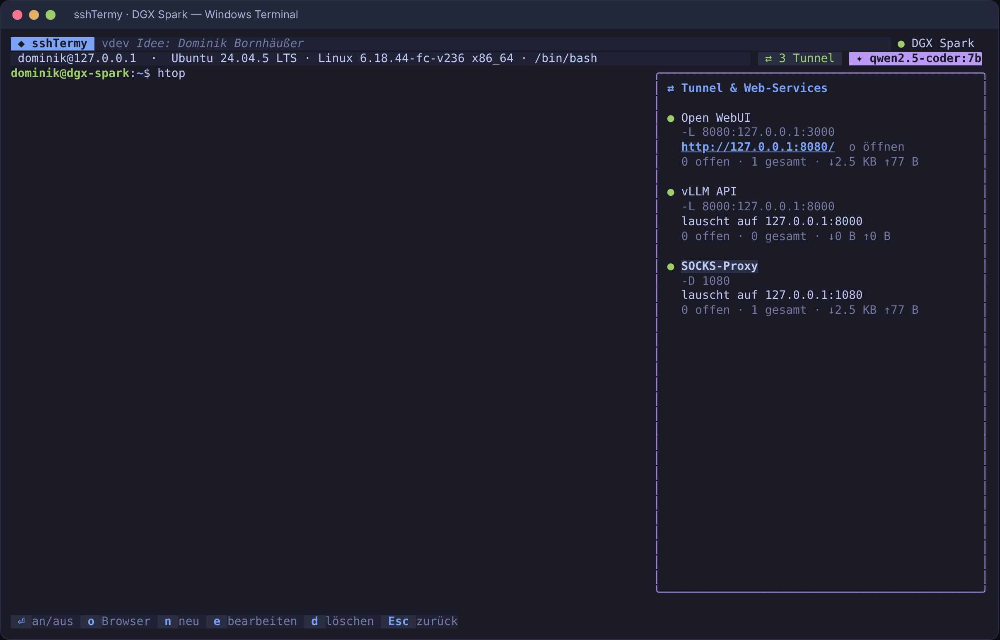 |

**Befehlspalette (Strg+Leertaste):** ein Feld für alles, Text wird zum Ziel oder zur Frage, darunter Vorschläge, Tunnel, Verbindungen und Aktionen.

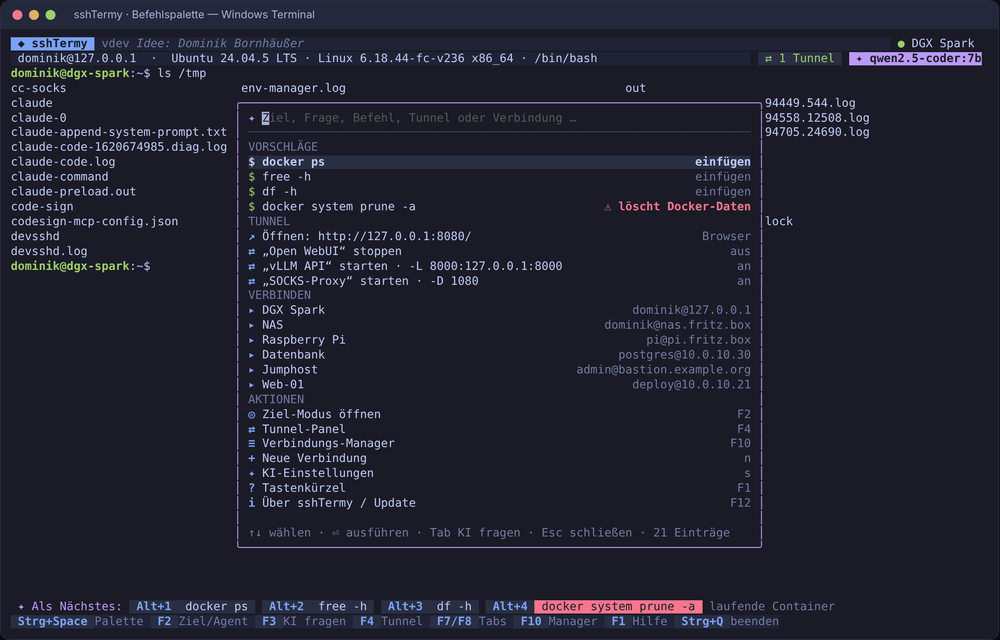

| Dateien (SFTP, F5) | Runbooks im Ziel-Modus |
|---|---|
| 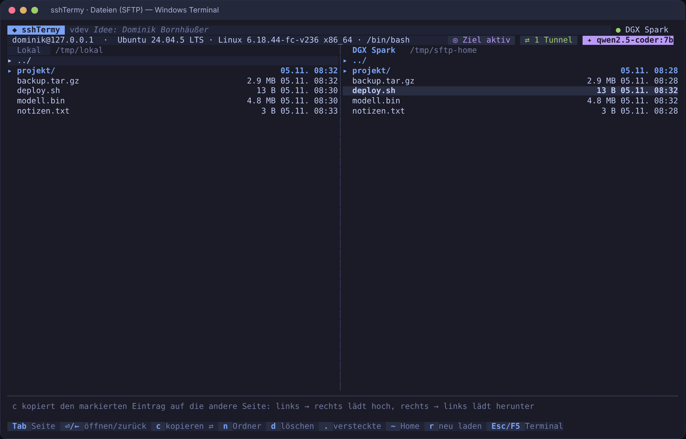 | 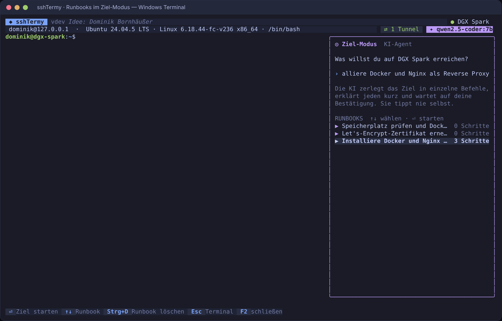 |
| **KI-Endpunkt testen, Modell wählen** | |
| 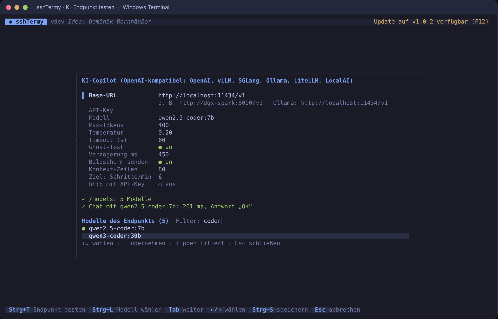 | |
| **Host-Übersicht Server (F6)** | **Switch: Übersicht und Config-Sicherung** |
| 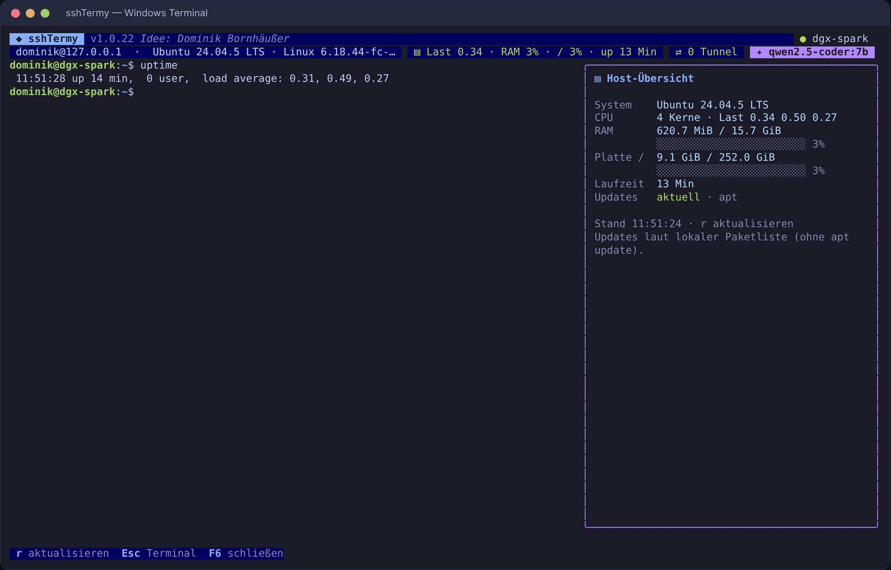 | 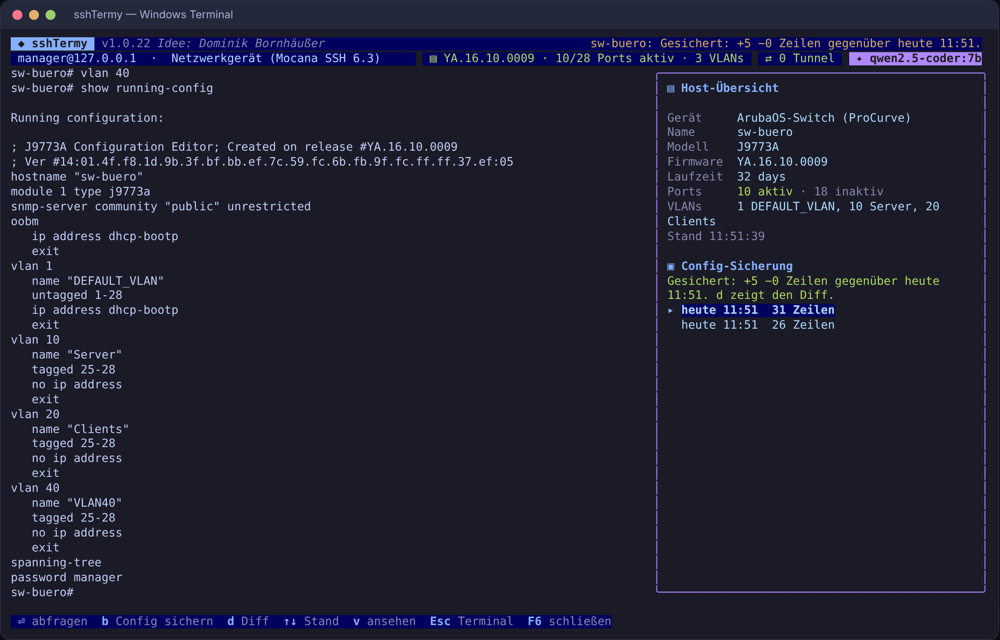 |

Die Bilder sind echte Aufnahmen der App (gegen einen Test-SSH-Server und ein Test-LLM aus `tools/dev`).

---

## Architektur

```
cmd/sshtermy/          Einstieg: Flags (--version, --update), Store öffnen, TUI starten
cmd/sshtermy-sign/     Ed25519-Schlüssel erzeugen, Releases signieren (CI)
internal/
  domain/              reine Datenmodelle: Connection, Tunnel, LLMConfig, Settings, Secret
  vault/               Verschlüsselung: AES-256-GCM, Argon2id, DPAPI (Windows)
  store/               Repository über dem Vault: CRUD, Pfade (%APPDATA%\sshtermy)
  sshx/                SSH: Dial (+Jump-Host), Auth (Passwort/Key/Agent), Host-Keys (TOFU),
                       PTY-Shell, Tunnel-Manager (-L/-R/-D), SOCKS5-Server, Browser öffnen
  llm/                 OpenAI-kompatibler Client (/v1/chat/completions, Streaming per SSE)
  agent/               KI-Logik: Ghost-Text, Folgebefehle, Ziel-Modus, Frage; Prompts,
                       striktes Parsen, Entfernen von Geheimnissen
  safety/              feste Gefahrenregeln (Linux/macOS und Windows/PowerShell)
  termemu/             Terminal-Emulation (charmbracelet/x/vt): Raster, Scrollback, Ghost-Overlay
  update/              Auto-Update aus GitHub Releases (SHA-256 + Ed25519)
  version/             Name, Version, Credits an genau einer Stelle
  ui/                  Oberfläche (bubbletea v2, lipgloss v2): Screens, Panels, Formulare
tools/dev/             Test-SSH-Server, Test-LLM, ANSI→HTML für Screenshots
```

Abhängigkeiten zeigen nur nach innen: `ui → agent/sshx/store/update → llm/safety/vault → domain`.
`domain` kennt nichts außer der Standardbibliothek.

### Ablauf

```
Start ─▶ Entsperren (DPAPI automatisch │ Master-Passwort │ Ersteinrichtung)
      ─▶ Verbindungs-Manager
           ├─ n/e  Formular (Alias, Host, Port, Benutzer, Auth, Gruppe, Tags, Jump-Host)
           ├─ t    Tunnel-Formular (local/remote/dynamic, Web-Service, Autostart)
           ├─ s    KI-Einstellungen (Base-URL, API-Key, Modell, Tokens, Temperatur …)
           └─ ⏎    Host-Key prüfen ─▶ Terminal-Tab
                     ├─ Ghost-Text (Pause beim Tippen → Vorschlag → Tab)
                     ├─ Enter → Ausgabe ruht → Folgebefehle als Chips
                     ├─ F2 Ziel → Schritt vorschlagen → ⏎ → Ausgabe ruht, Prompt da → nächster Schritt … ✓ fertig
                     ├─ F3 Frage (gestreamte Antwort, Befehle nummeriert)
                     └─ F4 Tunnel (Status, Zähler, URL)
```

### Technik-Entscheidungen

| Thema | Wahl | Grund |
|---|---|---|
| Sprache | Go 1.26 | Ein statisches Binary pro Plattform, Cross-Compile ohne Toolchain (`GOOS=windows GOARCH=arm64`), kein cgo |
| TUI | bubbletea v2 + lipgloss v2 | aktueller Charm-Stack: echte Cursor-Steuerung, Ebenen für Overlays, Kitty-Keyboard, Windows-Konsole |
| Terminal-Emulation | charmbracelet/x/vt | aktiv gepflegt, Truecolor, Alt-Screen, Scrollback, Breitzeichen; kodiert Tasten passend zum Modus |
| SSH | golang.org/x/crypto/ssh | Referenz-Implementierung in Go, Agent, known_hosts, Forwarding |
| Windows-Agent | Named Pipe via go-winio | Windows-OpenSSH-Agent (`\\.\pipe\openssh-ssh-agent`), 1Password, KeePassXC |
| Speicher | verschlüsselte JSON-Datei | eine Datei, atomar geschrieben, auch Metadaten (Hosts, Benutzer) verschlüsselt |

---

## Sicherheit

### Verschlüsselter Store (`internal/vault`)

```
Master-Passwort ──Argon2id (t=3, 64 MiB, p=4)──▶ KEK ──AES-256-GCM──┐
                                                                     ├─▶ DEK (256 Bit, zufällig)
Windows-Anmeldung ──DPAPI CryptProtectData───────────────────────────┘        │
                                                                               ▼
                                         AES-256-GCM(DEK) über den ganzen Store
```

- **DEK** (Data Encryption Key) aus `crypto/rand` verschlüsselt den **gesamten** Store in einem Stück
  (Passwörter, Private Keys, Passphrasen, API-Keys und auch Hostnamen, Benutzer, Tunnel).
- **AES-256-GCM** mit frischer 96-Bit-Nonce bei jedem Speichern. Der Header (KDF-Parameter, Wraps) ist als
  *Additional Authenticated Data* mitgeprüft: ein Herabsetzen der KDF-Parameter oder Vertauschen von Teilen
  lässt das Entschlüsseln scheitern (Test `TestTamperedHeaderIsRejected`).
- **Master-Passwort** wird nie gespeichert; **Argon2id** (RFC 9106) leitet daraus den KEK ab, der den DEK einwickelt.
- **DPAPI** (nur Windows, `CryptProtectData` ohne `LOCAL_MACHINE`, mit eigenem Entropy-Wert) bindet eine zweite
  Kopie des DEK an dein Windows-Konto: nach der Windows-Anmeldung entsperrt sich sshTermy ohne Eingabe, ist aber
  für andere Konten und Rechner unlesbar. Das Master-Passwort bleibt als Wiederherstellung (Umzug, macOS).
- Datei `store.vault` unter `%APPDATA%\sshtermy` (macOS `~/Library/Application Support/sshtermy`, Linux
  `~/.config/sshtermy`), Rechte 0600, atomar geschrieben. `SSHTERMY_HOME` für eine portable Installation.
- Automatische Sperre nach Leerlauf (`LockAfterMin`), DEK wird beim Sperren genullt (best effort).
- `domain.Secret` gibt sich in Logs und Fehlermeldungen nie preis (`••••••`).

### SSH

- **Host-Keys:** Trust On First Use mit SHA-256-Fingerprint im Dialog, eigene `known_hosts`. Ein **geänderter**
  Host-Key bricht die Verbindung ab, ohne „trotzdem verbinden“ (möglicher Man-in-the-Middle).
- Agent-Auth bevorzugt: Private Keys bleiben im Agent. Eingebettete Keys liegen nur verschlüsselt im Store.
- Tunnel binden standardmäßig auf `127.0.0.1`. SOCKS5 löst Namen auf dem Server auf (keine lokalen DNS-Leaks).

### KI

- Die KI **tippt nie selbst**. Jeder Befehl ist ein Vorschlag; erst deine Bestätigung sendet ihn ans PTY.
- **Feste Gefahrenregeln** (`internal/safety`), nie das Modell, entscheiden über Rot: `rm -rf`, `dd`, `mkfs`,
  `curl | sh`, Neustart, Firewall leeren, Benutzer ändern, `git reset --hard`, Pakete entfernen, Docker prune,
  SSH-Dienst stoppen; für Windows `Remove-Item -Recurse`, `Format-Volume`, `iex (iwr …)` u. a.
  Rote Befehle brauchen zwei Bestätigungen; bearbeitete Befehle werden neu geprüft. `sudo` wird markiert.
- **Prompt Injection:** alles aus dem Terminal steht als Material in einem Block `<<< … >>>`, dessen Marker im
  Inhalt entschärft werden; der System-Prompt sagt, dass Material nie eine Anweisung ist.
- **Striktes Parsen:** nur das erwartete JSON, keine Steuerzeichen (ESC-Sequenzen aus dem Modell kommen nie auf
  den Bildschirm), Längenlimits, `<think>` von Reasoning-Modellen wird entfernt.
- **Geheimnisse** (Private Keys, AWS/GitHub/OpenAI-Keys, Bearer-Token, `password=…`, `user:pass@`) werden vor dem
  Senden entfernt; an einer Passwortabfrage gibt es keinen Ghost-Text.
- API-Key geht nie per `http://` an einen fremden Host (außer bewusst erlaubt).
- Ratenlimit im Ziel-Modus (Standard 6 Schritte/min, max. 40 Schritte pro Ziel).

### Auto-Update

- Prüft `releases/latest` von `db9979/sshtermy`, nur HTTPS zu github.com, Weiterleitungen geprüft.
- **SHA-256** aus `checksums.txt` und **Ed25519-Signatur** `checksums.txt.sig` mit eingebautem Public Key.
- Austausch: laufende Datei → `.old`, neue an ihren Platz (geht auch unter Windows), beim nächsten Start aufgeräumt.

---

## Versionierung und Releases

- Version = `MAJOR.MINOR` aus [`VERSION`](VERSION) + Anzahl der Commits, z. B. `1.0.42`. **Jeder Push auf `main`
  zählt automatisch hoch** und erzeugt ein Release (`.github/workflows/release.yml`) mit allen Plattformen,
  `checksums.txt` und Signatur. Die App zeigt die Version in der Kopfzeile, im Über-Dialog (F12) und per `--version`.
- Neue Hauptversion: `VERSION` auf z. B. `1.1` setzen.
- Signierschlüssel einmalig anlegen:
  ```
  go run ./cmd/sshtermy-sign keygen
  ```
  Public Key als Repository-**Variable** `UPDATE_PUBKEY`, Private Key als **Secret** `UPDATE_SIGNING_KEY`
  (Settings → Secrets and variables → Actions). Ohne Schlüssel prüft das Update nur die SHA-256-Summe.

## Entwickeln

```
make test         # go vet + Tests
make build        # bin/sshtermy
make dist         # alle Plattformen nach dist/ + checksums.txt
```

Lokal testen ohne echten Server und ohne GPU:

```
cd tools/dev/devsshd && go run .          # Test-SSH-Server auf 127.0.0.1:2222 (jedes Passwort)
python3 tools/dev/fakellm.py              # Test-LLM auf 127.0.0.1:11434 (/v1/chat/completions)
SSHTERMY_HOME=/tmp/sth go run ./cmd/sshtermy
```

## Nächste Schritte (Vorschläge)

1. Windows-Ressourcen (Icon, Versionsinfo) und Code-Signing der `.exe`, macOS Notarisierung.
2. macOS-Schlüsselbund als zweiter Entsperr-Weg (wie DPAPI unter Windows).

## Sync zwischen Rechnern

Im Manager **y** drücken. Der Assistent fragt nur das Nötigste und prüft jede Angabe sofort live
(Name, Port, Zertifikat, Anmeldung, Ordner, Schreibrecht, vorhandene Sync-Datei). Bei Fehlern steht direkt
darunter, was zu tun ist, z. B. wo man in DSM oder QTS WebDAV einschaltet.

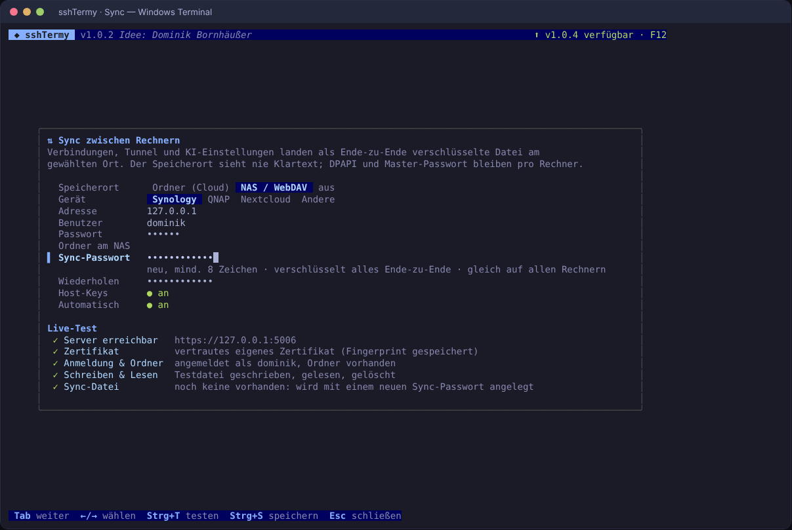

| Speicherort | Was du angibst | Hinweise |
|---|---|---|
| **Ordner (Cloud)** | einen Ordner in OneDrive, Dropbox, iCloud Drive, Nextcloud-Client, Syncthing oder auf einem Netzlaufwerk | Gefundene Cloud-Ordner werden vorgeschlagen. Konfliktkopien des Cloud-Dienstes werden automatisch eingearbeitet. |
| **NAS / WebDAV: Synology** | Name/IP, Benutzer, Passwort | Paket „WebDAV Server“ installieren, HTTPS aktivieren. sshTermy findet Port 5006/5005 selbst. Ordner z. B. `/home/sshtermy`. |
| **NAS / WebDAV: QNAP** | Name/IP, Benutzer, Passwort | Systemsteuerung › Netzwerk- & Dateidienste › WebDAV aktivieren. Ports 8081/443/8080/80 werden durchprobiert. |
| **NAS / WebDAV: Nextcloud** | Adresse, Benutzer, App-Passwort | Pfad `/remote.php/dav/files/<Benutzer>/` wird automatisch gebaut. |
| **Andere** | volle WebDAV-URL | jeder WebDAV-Server (Apache, nginx, rclone serve webdav …) |

Selbstsignierte NAS-Zertifikate: sshTermy zeigt den SHA-256-Fingerprint und merkt sich nach deiner Bestätigung genau
dieses Zertifikat (Pinning). Ändert es sich später, bricht der Sync mit einer Warnung ab.

**Sicherheit:** Synchronisiert wird nur die Datei `sshtermy-sync.vault`. Sie wird vor dem Hochladen mit einem eigenen
Sync-Schlüssel verschlüsselt (AES-256-GCM), der mit deinem Sync-Passwort (Argon2id) gesichert ist. NAS und Cloud sehen
keinen Klartext, auch keine Hostnamen. Der lokale Store bleibt wie bisher per Master-Passwort/DPAPI an den jeweiligen
Rechner gebunden; das Sync-Passwort gibst du pro Rechner nur einmal bei der Einrichtung ein.

**Zusammenführung pro Eintrag:** Jede Verbindung und jeder Tunnel trägt einen Änderungszeitstempel. Beim Abgleich gewinnt
pro Eintrag die neuere Änderung, gelöschte Einträge werden als Grabstein gemerkt (180 Tage), und „zuletzt benutzt“
zählt nicht als Änderung. So gehen Änderungen auf zwei Rechnern nicht verloren, solange sie verschiedene Einträge
betreffen. Abgeglichen wird beim Start, wenige Sekunden nach jeder Änderung und alle 5 Minuten; manuell über die Palette
(„Jetzt synchronisieren“). Nicht synchronisiert werden rechnerspezifische Dinge wie DPAPI und die Sync-Einstellungen selbst.

Zum Ausprobieren ohne NAS: `go run ./tools/dev/devdav` (http auf Port 5005) oder `go run ./tools/dev/devdav -tls -addr 127.0.0.1:5006`
(selbstsigniert), Benutzer `dominik`, Passwort `nas-pw`.
